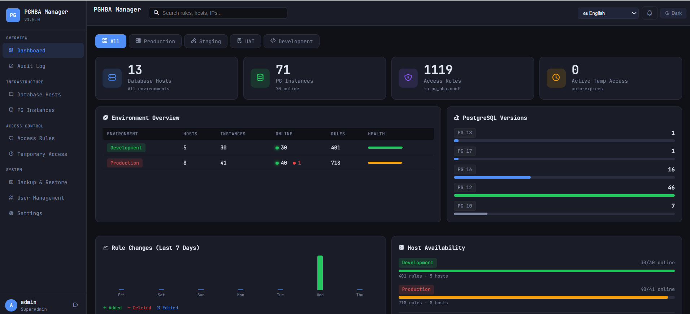
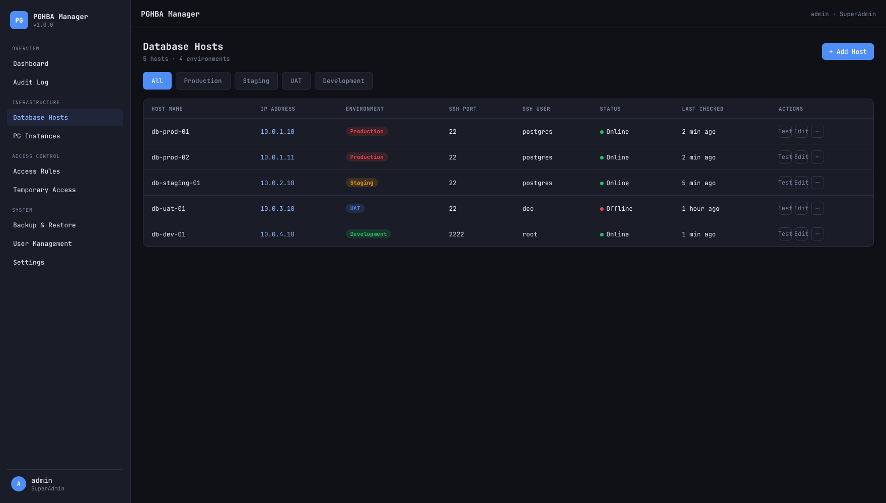
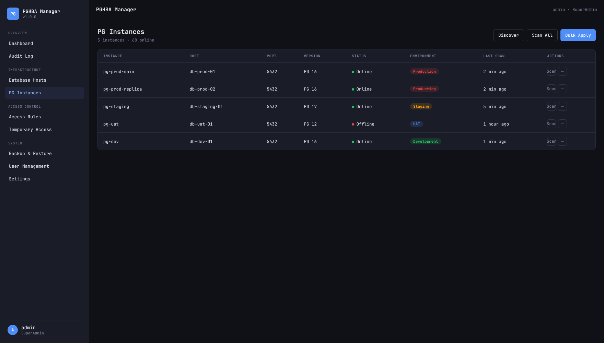
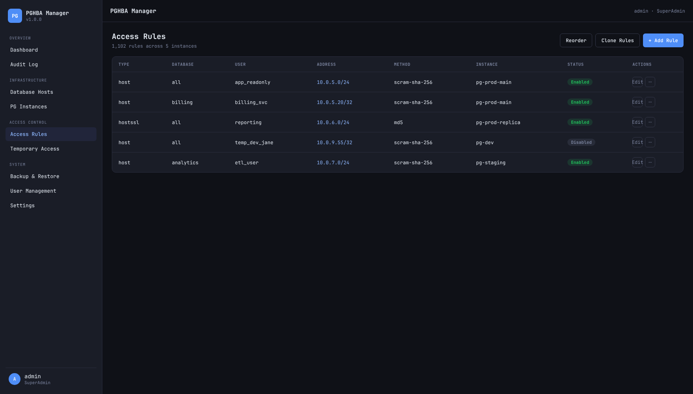
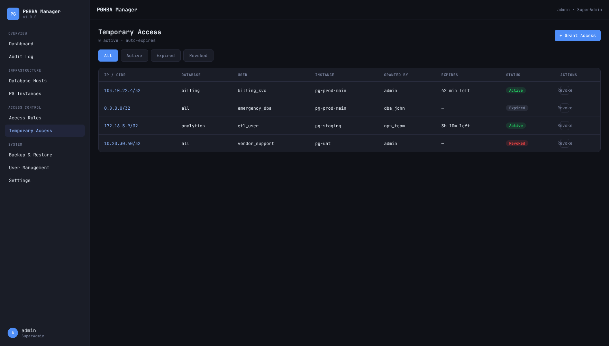
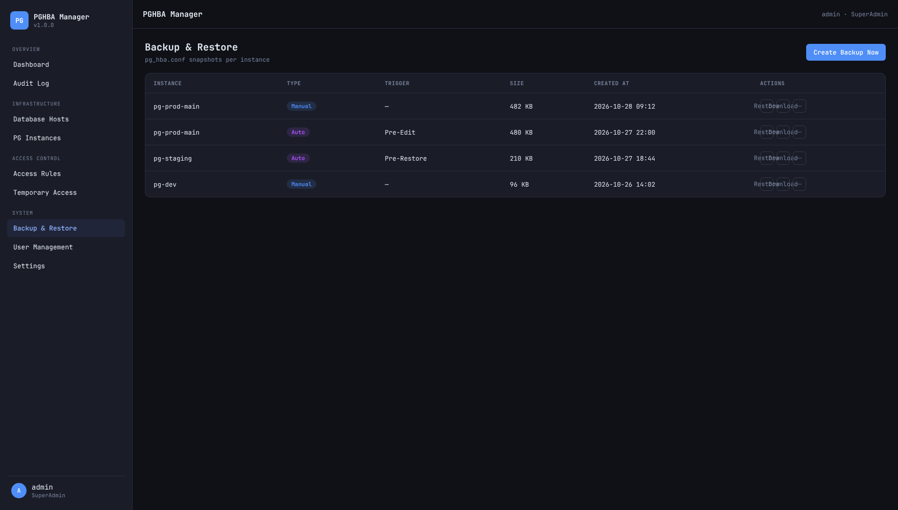
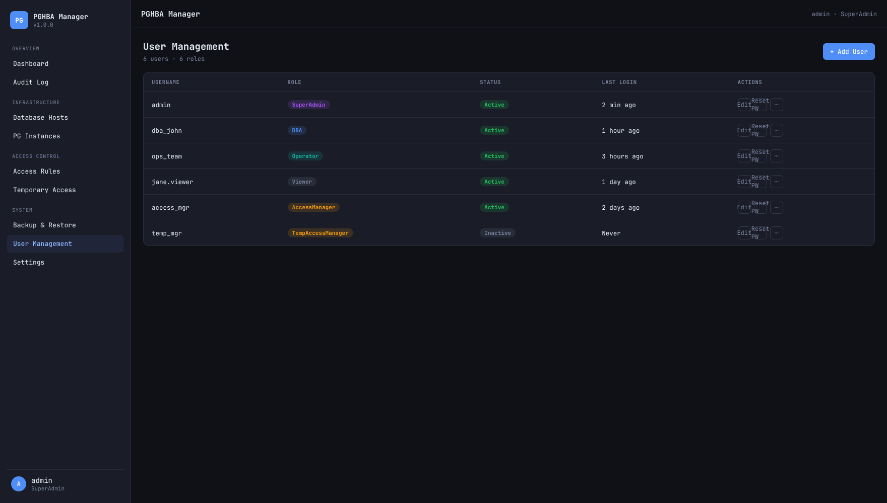
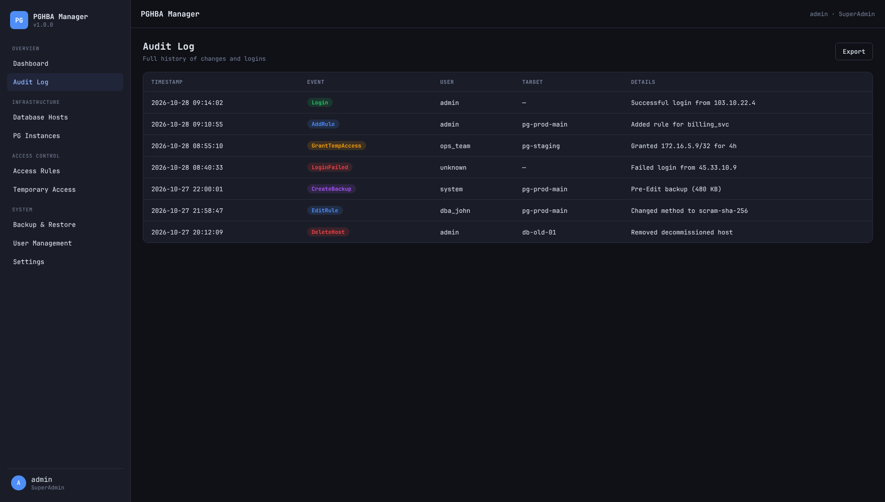
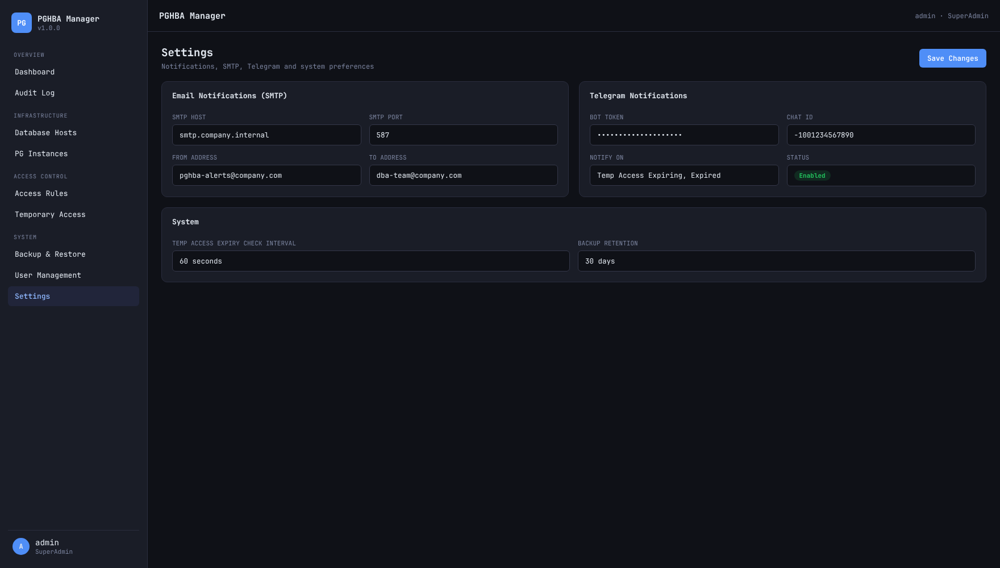

# PGHBA Fleet Manager

🇮🇩 [ID](README.md) · 🇬🇧 [EN](README.en.md) · 🇨🇳 [ZH](README.zh.md) · 🇪🇸 [ES](README.es.md) · 🇸🇦 [AR](README.ar.md) · 🇫🇷 [FR](README.fr.md) · 🇵🇹 [PT](README.pt.md) · 🇧🇩 [BN](README.bn.md) · 🇷🇺 [RU](README.ru.md) · 🇮🇳 [HI](README.hi.md) · 🇹🇭 [TH](README.th.md) · 🇰🇭 [KM](README.km.md) · 🇵🇭 [TL](README.tl.md) · 🇻🇳 [VI](README.vi.md) · 🇯🇵 [JA](README.ja.md) · 🇰🇷 [KO](README.ko.md) · 🇵🇱 [PL](README.pl.md) · 🇮🇹 **IT** · 🇹🇷 [TR](README.tr.md) · 🇮🇳 [TA](README.ta.md) · 🇮🇷 [FA](README.fa.md) · 🇺🇦 [UK](README.uk.md) · 🇩🇪 [DE](README.de.md) · 🇳🇱 [NL](README.nl.md)

Sistema di gestione centralizzata di `pg_hba.conf` PostgreSQL — gestisci le
regole di accesso su un'intera flotta di istanze PostgreSQL da un'unica
interfaccia web, invece di modificare manualmente `pg_hba.conf` su ogni
host.

Questo repository è uno snapshot protetto e pronto per il pubblico del
progetto originale PGHBA Manager: applicazione della password predefinita,
validazione dei segreti all'avvio, pinning delle chiavi host SSH,
limitazione del tasso di login e una pipeline CI che scansiona le
dipendenze a ogni push. Vedi [Sicurezza](#sicurezza) qui sotto.

[](https://www.paypal.com/donate/?business=b3n1_id@yahoo.com)
<br>☕ Offrimi un caffè.

---

## Screenshot

### Dashboard



> Gli screenshot qui sotto (Host database, Istanze PG, Regole di accesso,
> Accesso temporaneo, Backup e ripristino, Gestione utenti, Registro di
> audit, Impostazioni) sono **mockup illustrativi** costruiti a partire dai
> componenti frontend reali e dallo schema colori di questo repository,
> popolati con dati di esempio/fittizi — non è un deployment live. Gli
> screenshot reali li sostituiranno non appena disponibili.

<details>
<summary>Host database</summary>


</details>

<details>
<summary>Istanze PG</summary>


</details>

<details>
<summary>Regole di accesso</summary>


</details>

<details>
<summary>Accesso temporaneo</summary>


</details>

<details>
<summary>Backup e ripristino</summary>


</details>

<details>
<summary>Gestione utenti</summary>


</details>

<details>
<summary>Registro di audit</summary>


</details>

<details>
<summary>Impostazioni</summary>


</details>

---

## Avvio rapido (Docker)

```bash
# 1. Clona e configura
git clone https://github.com/ngebenis/pghba-fleet-manager.git
cd pghba-fleet-manager

# 2. Crea .env dal template (usato da docker-compose.yml)
cp backend/.env.example .env

# 3. Genera segreti reali — l'app rifiuta di avviarsi senza di essi
openssl rand -base64 48   # → JWT_SECRET
openssl rand -hex 32      # → ENCRYPTION_KEY

# 4. Modifica .env con i tuoi valori reali, poi:
docker compose up -d

# App disponibile su: http://localhost:8080
```

**Primo accesso**: `admin` / `Admin@1234`. Questo account è contrassegnato
per forzare il cambio password al primo accesso — il server blocca
qualsiasi altra azione finché non viene cambiata, quindi non c'è una
finestra in cui si "dimentica di cambiare la password predefinita".

---

## Configurazione per lo sviluppo

```bash
# Avvia solo il database
docker compose -f docker-compose.dev.yml up -d

# Backend (Go)
cd backend
cp .env.example .env       # modifica se necessario
go run ./cmd/server

# Frontend (Vue 3)
cd frontend
npm install
npm run dev
# → http://localhost:5173 (proxy /api verso :8080)
```

---

## Sicurezza

- **Nessuna configurazione predefinita non sicura può essere eseguita.**
  `main.go` chiama `config.Validate()` all'avvio, che impedisce l'avvio se
  `JWT_SECRET` o `ENCRYPTION_KEY` sono vuoti o ancora uguali al valore
  segnaposto pubblicato — un deployment configurato male fallisce in modo
  evidente invece di funzionare con un segreto JWT falsificabile o una
  chiave AES nota.
- **Le chiavi host SSH vengono fissate (pinning)**, non ignorate.
  `services.ConnectToHost` si fida della chiave SSH di un host gestito alla
  prima connessione e ne salva l'impronta
  (`db_hosts.ssh_host_key_fingerprint`); qualsiasi connessione successiva
  con una chiave diversa viene rifiutata invece di essere accettata
  silenziosamente. La cancellazione di un'impronta dopo una legittima
  ricostruzione dell'host avviene tramite un endpoint dedicato e tracciato
  (`POST /api/hosts/:id/reset-host-key`), mai tramite il normale form di
  modifica host.
- **Il login è limitato per frequenza**: 10 tentativi falliti da un unico
  IP entro 15 minuti bloccano quell'IP per 15 minuti.
- **La disattivazione o la retrocessione di un utente ha effetto
  immediato** — ogni richiesta autenticata riverifica stato/ruolo rispetto
  al database invece di fidarsi di quanto dichiarato da un JWT emesso fino
  a 8 ore prima.
- **La CI scansiona le dipendenze con vulnerabilità note** a ogni push/PR
  e settimanalmente (`.github/workflows/security.yml`): `govulncheck` per
  il backend Go, `npm audit` (dipendenze di produzione) per il frontend.
- L'esportazione dei backup, il CORS e gli header delle risposte HTTP sono
  protetti — vedi `backend/internal/handlers/export.go` (sanitizzazione
  dei segmenti di percorso), `backend/internal/server/router.go` (il CORS
  blocca per default l'accesso cross-origin a meno che non sia impostato
  `CORS_ALLOWED_ORIGINS`) e `backend/internal/middleware/security_headers.go`.
- **Rotazione dei segreti dopo una fuga di dati**:
  `backend/cmd/reencrypt-ssh-keys` e
  [`docs/rotate-secrets.md`](docs/rotate-secrets.md) guidano nella
  rotazione di `JWT_SECRET`/`ENCRYPTION_KEY` e nella ricifratura di ogni
  chiave SSH memorizzata senza perdita di dati.

---

## Struttura del progetto

```
pghba-fleet-manager/
├── backend/
│   ├── cmd/
│   │   ├── server/main.go              # Punto di ingresso
│   │   └── reencrypt-ssh-keys/         # Strumento di rotazione segreti (vedi Sicurezza)
│   └── internal/
│       ├── config/                     # Loader di configurazione + validazione segreti all'avvio
│       ├── database/                   # Connessione GORM
│       ├── models/                     # Tutti i modelli GORM
│       ├── middleware/                 # Autenticazione JWT, RBAC, rate limiting, security header
│       ├── handlers/                   # Handler HTTP Gin
│       │   ├── auth.go                 # Login / logout / refresh / cambio password
│       │   ├── hosts.go                # CRUD host, validazione SSH, deploy chiave, reset chiave host
│       │   ├── instances.go            # Scoperta/scansione istanze
│       │   ├── rules.go                # CRUD regole pg_hba + enable/disable/riordina/clona
│       │   ├── temp_access.go          # Concessione/revoca accesso temporaneo
│       │   ├── backup.go, backup_schedules.go   # Creazione/ripristino/download backup + pianificazione
│       │   ├── export.go               # Esportazione config/backup (locale + S3)
│       │   ├── healthcheck.go          # Controllo stato host + notifiche
│       │   ├── users.go                # CRUD utenti (solo SuperAdmin)
│       │   ├── audit.go                # Elenco registro audit + diff
│       │   └── dashboard.go, settings.go, conflicts.go, notifications.go
│       ├── services/
│       │   ├── ssh.go                  # Client SSH, pinning chiavi host (ConnectToHost)
│       │   ├── hba.go, hba_writer.go    # Rendering contenuto pg_hba + scrittura atomica + scadenza
│       │   ├── crypto.go               # AES-256-GCM per le chiavi SSH
│       │   ├── audit.go, notifier.go
│       ├── scheduler/                  # Cron — fa scadere le regole temporanee ogni N minuti
│       └── server/router.go            # Router Gin, CORS, tutte le rotte
│
├── frontend/
│   └── src/
│       ├── api/index.ts                # Client API Axios
│       ├── types/index.ts              # Interfacce TypeScript (rispecchiano i modelli Go)
│       ├── stores/auth.ts              # Store di autenticazione Pinia
│       ├── router/index.ts             # Vue Router con guard di auth + cambio password forzato
│       ├── components/layout/AppLayout.vue
│       └── views/                      # Una vista per area funzionale
│
├── database/migrations/
│   ├── 001_init.sql                    # Schema completo con enum, indici, trigger
│   └── 002–007_*.sql                   # Ruoli RBAC, pianificazioni backup, hardening password/chiave host
│
├── docs/rotate-secrets.md              # Runbook di rotazione segreti
├── .github/workflows/security.yml      # CI: build/vet/govulncheck + npm audit
├── Dockerfile                          # Multi-stage: build Vue + build Go → alpine
├── docker-compose.yml                  # Produzione
└── docker-compose.dev.yml              # Sviluppo (solo DB)
```

---

## Riferimento API

L'elenco completo delle rotte si trova in
`backend/internal/server/router.go`. Endpoint principali:

```
POST   /api/auth/login
POST   /api/auth/logout
POST   /api/auth/refresh
POST   /api/auth/change-password
GET    /api/auth/me

GET    /api/dashboard/stats

GET    /api/hosts
POST   /api/hosts
PUT    /api/hosts/:id
DELETE /api/hosts/:id
POST   /api/hosts/validate              # SSH pre-flight check before saving
POST   /api/hosts/:id/deploy-key
POST   /api/hosts/:id/reset-host-key    # Clear pinned SSH host key fingerprint

GET    /api/instances
POST   /api/instances/discover
POST   /api/instances/:id/scan

GET    /api/rules
POST   /api/rules
PUT    /api/rules/:id
DELETE /api/rules/:id
POST   /api/rules/:id/enable
POST   /api/rules/:id/disable
POST   /api/rules/reorder
POST   /api/rules/clone

GET    /api/temporary-access
POST   /api/temporary-access
POST   /api/temporary-access/:id/revoke

GET    /api/backups
POST   /api/backups
POST   /api/backups/:id/restore
GET    /api/backups/:id/download
GET    /api/backup-schedules

GET    /api/users
POST   /api/users
PUT    /api/users/:id
POST   /api/users/:id/reset-password
DELETE /api/users/:id

GET    /api/audit
GET    /api/audit/diff/:id
```

---

## Permessi RBAC

| Funzionalità            | SuperAdmin | DBA | Operator | Viewer | AccessManager | TempAccessManager |
|--------------------------|:----------:|:---:|:--------:|:------:|:-------------:|:-----------------:|
| Gestione host             | ✓          | ✓   |          |        |               |                    |
| Gestione istanze          | ✓          | ✓   |          |        |               |                    |
| Aggiungi/modifica/elimina regola | ✓   | ✓   |          |        | ✓             |                    |
| Abilita/disabilita regola | ✓          | ✓   | ✓        |        | ✓             |                    |
| Visualizza regole         | ✓          | ✓   | ✓        | ✓      | ✓             |                    |
| Concedi/revoca accesso temporaneo | ✓  | ✓   | ✓        |        | ✓             | ✓                  |
| Backup e ripristino       | ✓          | ✓   |          |        |               |                    |
| Gestione utenti           | ✓          |     |          |        |               |                    |
| Visualizza registro audit | ✓          | ✓   |          |        |               |                    |

`AccessManager` e `TempAccessManager` sono ruoli con ambito limitato per i
team che devono gestire solo le regole di accesso / l'accesso temporaneo,
senza i pieni privilegi da DBA su host, istanze, backup o utenti.

---

## Checklist per la produzione

- [ ] Imposta `JWT_SECRET`/`ENCRYPTION_KEY` reali — altrimenti l'app non si avvia
- [ ] Accedi una volta e cambia la password admin predefinita (obbligatorio al primo accesso)
- [ ] Imposta una `DB_PASSWORD` robusta
- [ ] Abilita TLS (`DB_SSL_MODE=require`)
- [ ] Metti l'app dietro NGINX/Traefik con HTTPS
- [ ] Limita la porta di Postgres solo alla rete interna
- [ ] Imposta `CORS_ALLOWED_ORIGINS` solo se il frontend è distribuito su un'origine diversa dall'API
